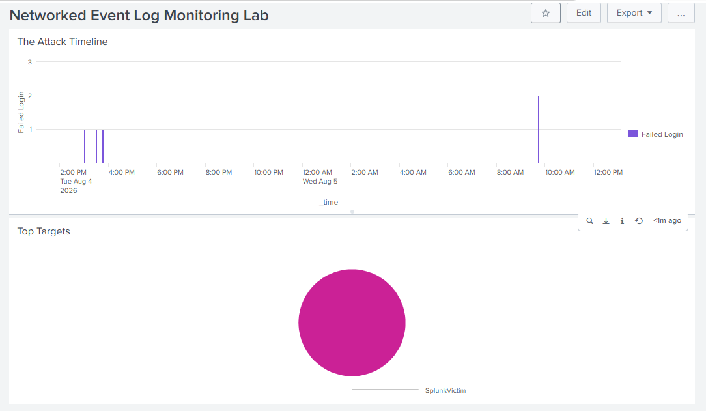

# Threat Hunting and Incident Response with Splunk: Brute-Force Detection in a Segmented Lab



## Objective
Build a small SIEM, simulate a brute-force credential attack, and detect it in Splunk: the same detect → triage → respond loop a Tier 1 SOC analyst runs every shift.

## Architecture
```
 [Endpoint / Victim]                      [SOC Analyst]
 Windows + Splunk Universal Forwarder     Splunk Enterprise (Docker)
 192.168.1.11                             192.168.1.10
        │  Windows Security log                  ▲
        └────────── TCP 9997 ────────────────────┘
                 Cisco switch, VLAN 10 (192.168.1.0/24)
```

## Tools
Splunk Enterprise (Docker Compose) · Splunk Universal Forwarder · SPL · Windows Event Logs · PowerShell · Windows Defender Firewall · Cisco IOS (VLANs)

## What I built
1. **Network:** Cisco switch configured with VLAN 10 and static IPv4 addressing to isolate a two-host lab ([network/switch-config.txt](network/switch-config.txt)).
2. **Boundary protection:** host firewall rules allowing only ICMPv4 and TCP 9997 inbound to the SIEM.
3. **SIEM:** containerized Splunk Enterprise with persistent volumes ([docker-compose.yml](docker-compose.yml)).
4. **Log collection:** Universal Forwarder shipping the Windows Security log ([forwarder/](forwarder/)).
5. **Attack simulation:** PowerShell brute-force against a test account with a 3-attempt lockout policy ([attack/bruteforce-sim.ps1](attack/bruteforce-sim.ps1)).
6. **Detection and response:** SPL threat-hunting searches, a dashboard, and a real-time lockout alert ([detections/searches.spl](detections/searches.spl)).

## Detections (MITRE ATT&CK)
| Technique | Evidence (IOC) | Detection |
|---|---|---|
| T1110 Brute Force | Event ID 4625, repeated failed logons for one account | Attack Timeline + Top Targets dashboard panels |
| T1110 Brute Force | Event ID 4740, account locked out | Real-time alert on every lockout |

## Results
- Failed logons from the simulated attack appeared on the Attack Timeline as they happened.
- The Top Targets panel identified the targeted account (`SplunkVictim`) with no raw-log digging.
- The lockout event fired the alert once the threshold was reached.

## Problems I solved
- **Searches returned zero.** Instead of rewriting the SPL, I checked whether data was flowing (`index=* | stats count by sourcetype`). No `WinEventLog:Security` sourcetype → the problem was upstream. Restarting the forwarder applied `inputs.conf` and data appeared.
- **Forwarder pointed at the wrong port and IP.** `outputs.conf` used 8089 (management port) instead of 9997, and the wrong destination IP. Fixed both, then verified with `Test-NetConnection -Port 9997` and `splunkd.log`. Full log: [docs/troubleshooting.md](docs/troubleshooting.md).

## Incident report
[docs/incident-report.md](docs/incident-report.md): detection, triage, containment, and lessons learned.

## Lessons learned
- Validate the pipeline (source → sourcetype → index → search) before trusting a query.
- An open port is not the same as a working connection; confirm in the logs.
- Alert on the high-signal event (lockout), and use the noisy event (failed logons) for context.

## Run it yourself
```bash
cp .env.example .env        # set your own password
docker compose up -d        # Splunk Web on http://localhost:8000
```
> Lab use only. Run the attack script only on machines you own, on an isolated network.

---
**Fabian Hewitt** · CompTIA Security+ · Splunk Core Certified Power User · [LinkedIn](https://www.linkedin.com/in/fabian-hewitt-792712250)
